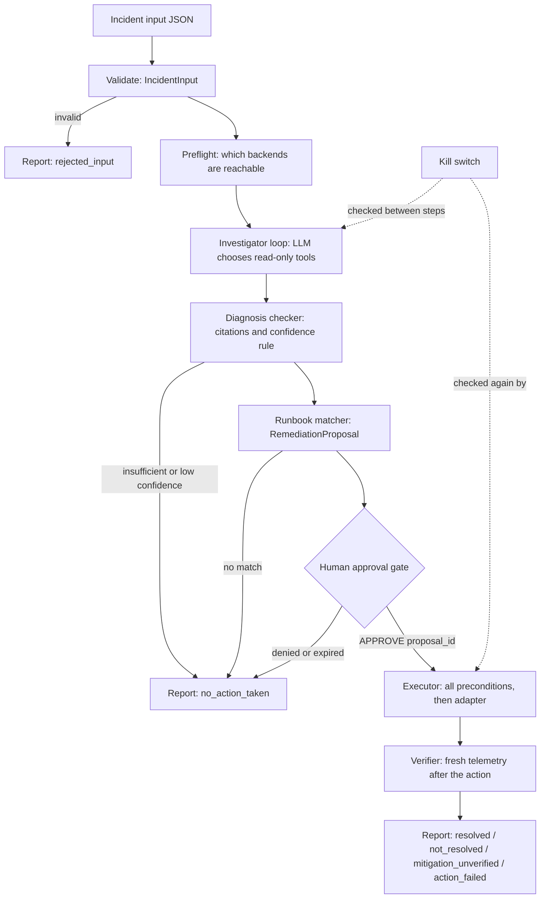

# Architecture (draft by Person 1, review before submission)

## In plain English

`oncall-agent` is a Python command-line program that behaves like an on-call engineer for the OpenTelemetry Astronomy Shop. Given an incident, it reads real telemetry (metrics, traces, logs, container state) through read-only tools, asks a language model to reason over the evidence, and produces a diagnosis in which every claim cites evidence that a tool actually returned. It then proposes one fix from an approved runbook, waits for a human to type an exact approval phrase, executes through the Action API adapter, verifies recovery with fresh telemetry, and writes a JSON and Markdown report. When it is not confident, it says so and escalates instead of acting.

## Flow

The orchestrator (`oncall/orchestrator.py`) drives this flow. It records every state change in the report timeline, checks the kill switch between steps, and turns any exception into a limitation plus the right `final_status`, so a report is always produced.

## What the LLM does and what plain code does

| Decision | Who decides |
|---|---|
| Which read-only tool to call next, and how to explain the evidence | LLM |
| Whether each cited evidence ID exists | Code (diagnosis checker) |
| Final confidence level | Code (rule in PLAN.md 22.5) |
| Whether a runbook may be proposed (diagnosed, root cause set, confidence at least medium) | Code (orchestrator and runbook matcher) |
| Whether an action may run (approval, hash, expiry, single use, duplicate, cooldown, kill switch) | Code (executor) |
| Whether the system recovered | Code (verifier, on fresh telemetry) |
| Final status of the incident | Code (`derive_final_status`) |

The LLM has no tool that can change the system. Its only special tools record a diagnosis or a remediation request.

## Components and owners

| Component | Files | Owner |
|---|---|---|
| Contracts, config, orchestrator | `oncall/contracts.py`, `config.py`, `orchestrator.py` | P1 |
| Telemetry tools | `oncall/tools/*` | P2 |
| LLM client, investigator, diagnosis checker, fallback | `oncall/agent/*` | P3 |
| Runbooks, approval, ledger, kill switch, executor, adapters, verifier | `oncall/safety/*` | P4 |
| CLI, reports, scenarios, end-to-end tests | `oncall/cli.py`, `oncall/report/*`, `scenarios/*` | P5 |

## Existing versus new

Existing, unchanged: the Astronomy Shop services, the OpenTelemetry Collector, Prometheus, Jaeger, OpenSearch. New: everything under `oncall-agent/`.

## Data sources

Prometheus (span metrics), Jaeger v3 (traces), OpenSearch (logs, with `docker logs` as fallback), and Docker (`docker inspect`). The agent does not read feature-flag settings: it reasons from telemetry only, as the hackathon rules require.

## Safety controls

- Human approval: exact phrase `APPROVE <proposal_id>`, bound to a hash of the proposal, single use, expires after 10 minutes. Anything else is a denial.
- Kill switch: `ONCALL_KILL_SWITCH=1` or the file `state/KILL_SWITCH`. Checked between steps and again by the executor. A read error means ON.
- Allowlisted runbook actions only. Draft runbooks are not executable unless explicitly enabled for practice.
- Duplicate-action ledger and a 10-minute cooldown per action and target.
- Simulated actions are labelled everywhere, and a simulated action can never produce `resolved`.
- No action API retries. A side effect is never retried automatically.
- Verification uses fresh telemetry, never just an API success code.
- Incident text and log lines are treated as untrusted data.
